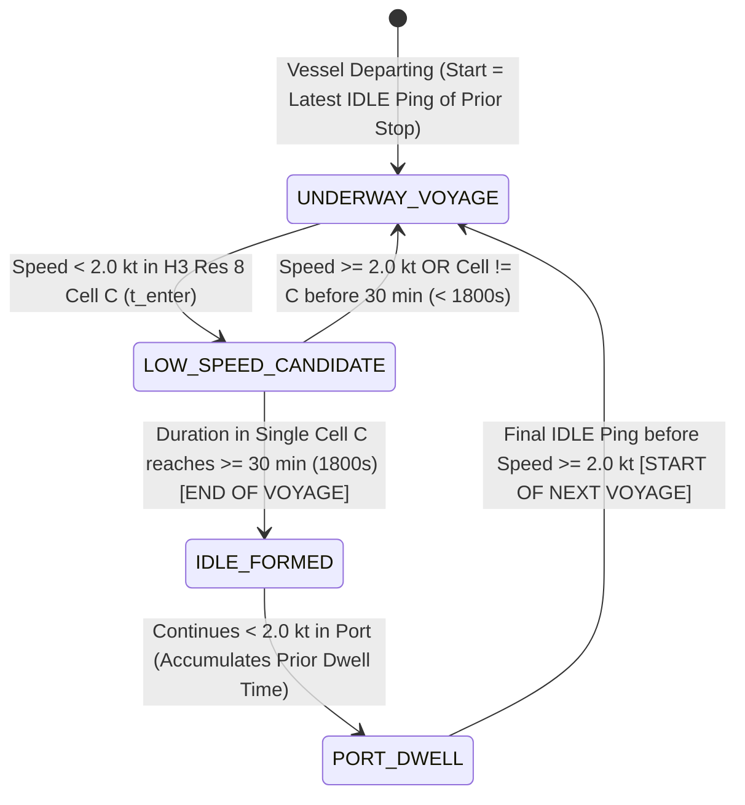

# Maritime Spatiotemporal Lakehouse — Data Dictionary & Architecture Specification

## 1. Executive Summary & 100GB+ DuckDB Lakehouse Architecture

The **simsim & spatA Maritime Telemetry Lakehouse** implements a four-tier Medallion Architecture (**Raw $\to$ Bronze $\to$ Silver $\to$ Gold**) backed by an in-process columnar **DuckDB Lakehouse (`data/datalake.duckdb`)** engineered for **100+ vessels** and **100GB+ of AIS telemetry points**.

```mermaid
flowchart LR
    subgraph Raw["1. Raw Tier (data/raw/)"]
        R1["Pristine AIS Feeds & CSV Dumps"]
    end

    subgraph Bronze["2. Bronze Tier (data/bronze/ & bronze_telemetry)"]
        B1["10-Column IMO A.1106(29) Validation"]
        B2["Compound Index: (IMO, DateTime)"]
    end

    subgraph Silver["3. Silver Tier (data/silver/ & silver_kinematics / silver_voyages)"]
        S1["Point-to-Point Derived Kinematics & Uber H3 Res 8/7"]
        S2["IDLE State Machine (< 2.0 kt in 1 H3 Res 8 Cell >= 30m)"]
        S3["Stop-to-Stop Silver Voyage Segmentation (VOY-01..VOY-N)"]
    end

    subgraph Gold["4. Gold Tier (data/gold/ & gold_voyages / gold_markov_transitions)"]
        G1["4 Core Voyage KPIs & Safety Breakdown"]
        G2["3rd-Order Markov Chain Matrix & Top-3 Spectrum"]
        G3["Jensen-Shannon Divergence (JSD) Predictability"]
    end

    Raw --> Bronze --> Silver --> Gold
```

### High-Scale DuckDB Optimization Pillars (100GB+ / 100+ Vessels)
1. **Vectorized Bulk Ingestion (`con.register` & `read_csv`)**:
   - Eliminates row-by-row SQL `INSERT` bottlenecks in favor of zero-copy Apache Arrow / Pandas registration (`con.register`) and DuckDB's multi-threaded C++ vectorized CSV/Parquet scanner (`read_csv`).
2. **Engine Pragmas**:
   - `SET threads TO <cpu_cores>`: Parallel execution across all physical/logical CPU cores.
   - `SET memory_limit = '8GB'`: Out-of-core spill-to-disk buffer management for 100GB+ scans.
   - `SET preserve_insertion_order = false`: Maximizes parallel pipeline throughput during bulk transformations.
3. **Compound & Spatial Indexing**:
   - `idx_bronze_imo_time` on `bronze_telemetry (IMO, DateTime)`
   - `idx_silver_imo_time` on `silver_kinematics (IMO, DateTime)`
   - `idx_silver_voyage_time` on `silver_kinematics (voyage_id, DateTime)`
   - `idx_silver_global_voyage_time` on `silver_kinematics (global_voyage_id, DateTime)`
   - `idx_silver_h3` on `silver_kinematics (h3_res8)`
   - `idx_silver_voyages_imo` on `silver_voyages (imo, departure_utc)`

---

## 2. Silver-Tier IDLE & Stop-to-Stop Voyage Segmentation Specification

All voyage segmentation and stationary dwell detection occur directly in the **Silver Tier** (`silver_kinematics` and `silver_voyages` in `data/datalake.duckdb`, exported to `data/silver/silver_voyages.json` and `data/silver/*_silver.csv`).

### 2.1 Strict IDLE Condition
A vessel transitions into the **`IDLE`** state when **both** conditions hold continuously for at least **30 minutes ($\ge 1800\text{ seconds}$)**:
1. **Low Kinematic Speed**: Reported or derived speed over ground is strictly under $2.0\text{ knots}$ ($\text{SOG} < 2.0\text{ kt}$ or $\text{calc\_sog\_kts} < 2.0\text{ kt}$).
2. **Single H3 Cell Confinement**: The vessel remains inside **1 single Uber H3 Resolution 8 hexagon (`h3_res8`)** without crossing into a different cell before the 30-minute threshold is satisfied:
   $$\Delta t_{\text{cell}}(i) = t_i - t_{\text{enter\_cell}} \ge 1800\text{ s} \quad \text{where } \forall k \in [\text{enter\_cell}, i]: \text{h3\_res8}_k = C \land v_k < 2.0\text{ kt}$$

### 2.2 Stop-to-Stop Voyage Boundary Definition
A **Voyage** (`VOY-01`, `VOY-02`, ...) is defined as the sequence of telemetry pings between two consecutive stops (`IDLE` periods):
- **Start of Voyage ($t_{\text{start}}$)**: The **latest timestamp the vessel was IDLE** in the departure stop (the final ping of the departure `IDLE` block right before the vessel accelerates to $\ge 2.0\text{ kt}$).
- **End of Voyage ($t_{\text{end}}$)**: The **first moment a new IDLE has formed (after 30 minutes)** at the arrival stop (the exact ping where cumulative duration $< 2.0\text{ kt}$ inside that single `h3_res8` cell reaches $\ge 1800\text{ seconds}$).
- **Port Dwell / Previous Dwell Time Attribution (`prior_dwell_time_hrs`)**:
  - Pings occurring *after* the 30-minute IDLE formation threshold up until the final IDLE ping before the next departure belong to the inter-voyage port dwell (`DWELL-01`, `DWELL-02`, ..., `motion_state = 'IDLE'`).
  - The total duration of the departure stop ($\Delta t_{\text{dwell}} = t_{\text{last\_idle}} - t_{\text{enter\_idle}}$) is recorded as **`prior_dwell_time_hrs`** (and formatted as **`prior_dwell_formatted`**, e.g. `4h 30m`) on the subsequent voyage.

---

## 3. DuckDB Schema Reference (`data/datalake.duckdb`)

### 3.1 `bronze_telemetry` (Canonical 10-Column Schema + Ingestion Metadata)

| Column | DuckDB Type | Unit / Format | Description |
| :--- | :--- | :--- | :--- |
| `DateTime` | `TIMESTAMP` | ISO-8601 UTC | Transmission timestamp (`YYYY-MM-DDTHH:MM:SSZ`) |
| `LAT` | `DOUBLE` | Decimal Degrees | WGS-84 Latitude ($[-90.0, 90.0]$) |
| `LON` | `DOUBLE` | Decimal Degrees | WGS-84 Longitude ($[-180.0, 180.0]$) |
| `SOG` | `DOUBLE` | Knots (`kt`) | Reported Speed Over Ground |
| `COG` | `DOUBLE` | Degrees $[0, 360)$ | Reported Course Over Ground |
| `Heading` | `DOUBLE` | Degrees $[0, 360)$ | True Vessel Heading |
| `Name` | `VARCHAR` | String | Commercial Vessel Name (e.g., `NEW CAMELLIA`) |
| `IMO` | `VARCHAR` | `IMO9xxxxxx` | 7-Digit IMO Vessel Identifier |
| `Type` | `INTEGER` | AIS Code | AIS Ship Type (`60`: Passenger/Ro-Pax, `70`: Cargo) |
| `Status` | `INTEGER` | AIS Code | Navigational Status (`0`: Underway, `1`: At Anchor, `5`: Moored) |
| `source_file` | `VARCHAR` | Filename | Originating Bronze CSV file |
| `ingested_at` | `TIMESTAMP` | UTC Timestamp | Lakehouse ingestion audit timestamp |

---

### 3.2 `silver_kinematics` (Point-to-Point Kinematics, H3 Spatial Grid & IDLE State)

| Column | DuckDB Type | Formula / Rule | Description |
| :--- | :--- | :--- | :--- |
| `DateTime` | `TIMESTAMP` | UTC | Chronological ping timestamp |
| `LAT`, `LON` | `DOUBLE` | WGS-84 | Validated geographic coordinates |
| `SOG`, `COG`, `Heading` | `DOUBLE` | AIS Sensor | Raw sensor telemetry |
| `Name`, `IMO` | `VARCHAR` | Identity | Vessel identity |
| `Type`, `Status` | `INTEGER` | AIS Code | Vessel type and nav status |
| `calc_sog_kts` | `DOUBLE` | $\Delta d_i / \Delta t_i$ | Derived point-to-point speed in knots (clamped $[0, 35]\text{ kt}$) |
| `calc_sog_mps` | `DOUBLE` | $\text{calc\_sog\_kts} \times 0.514444$ | Derived speed in meters per second ($\text{m/s}$) |
| `calc_cog_deg` | `DOUBLE` | $\text{Bearing}(p_{i-1} \to p_i)$ | Forward geodesic azimuth in degrees $[0, 360)$ |
| `calc_accel_kts_min` | `DOUBLE` | $\Delta v_i / \Delta t_{\min}$ | Longitudinal acceleration in knots per minute |
| `calc_rot_deg_min` | `DOUBLE` | $\Delta \theta_i / \Delta t_{\min}$ | Angular Rate of Turn (ROT) in degrees per minute |
| `delta_dist_nm` | `DOUBLE` | Haversine ($\text{NM}$) | Great-circle distance from previous ping |
| `delta_time_s` | `DOUBLE` | $t_i - t_{i-1}$ ($\text{s}$) | Elapsed time interval from previous ping in seconds |
| `motion_state` | `VARCHAR` | State Machine | `IDLE`, `MOORED`, `ACCELERATING`, `DECELERATING`, or `CRUISING` |
| `is_idle` | `BOOLEAN` | $<2\text{ kt}, 1\text{ cell}, \ge 1800\text{s}$ | `TRUE` if ping belongs to a confirmed $\ge 30\text{m}$ single-cell IDLE stop |
| `idle_cell_duration_s` | `DOUBLE` | $t_i - t_{\text{enter\_cell}}$ | Cumulative seconds spent $< 2.0\text{ kt}$ in the current `h3_res8` cell |
| `h3_res8` | `VARCHAR` | Uber H3 Res 8 | Hexagonal spatial index ($\sim 0.74\text{ km}^2$ area) |
| `h3_res7` | `VARCHAR` | Uber H3 Res 7 | Coarser regional hexagonal index ($\sim 5.16\text{ km}^2$ area) |
| `point_safety_score` | `DOUBLE` | $100 - \sum \text{Penalties}$ | Dynamic point-level kinematic safety rating ($[0, 100]$) |
| `voyage_id` | `VARCHAR` | `VOY-01` / `DWELL-01` | Clean per-vessel voyage code or inter-voyage port dwell ID |
| `global_voyage_id` | `VARCHAR` | `VOY_<STEM>_01` | Globally unique voyage identifier across all datasets |
| `source_file` | `VARCHAR` | `*_silver.csv` | Silver dataset filename |

---

### 3.3 `silver_voyages` & `gold_voyages` (Segmented Stop-to-Stop Voyages & 4 Core KPIs)

| Column | DuckDB Type | Example | Description |
| :--- | :--- | :--- | :--- |
| `voyage_id` | `VARCHAR` | `VOY-01` | Clean sequential voyage code for the active vessel |
| `global_voyage_id` | `VARCHAR PK` | `VOY_NEW_CAMELLIA_01` | Globally unique primary key across the lakehouse |
| `vessel_name` | `VARCHAR` | `NEW CAMELLIA` | Commercial vessel name |
| `imo` | `VARCHAR` | `IMO9304497` | IMO number |
| `mmsi` | `VARCHAR` | `440123456` | 9-digit Maritime Mobile Service Identity |
| `vessel_type` | `INTEGER` | `60` | AIS vessel type code |
| `origin_port` | `VARCHAR` | `Busan North Port (KR)` | Resolved departure port / maritime zone |
| `destination_port` | `VARCHAR` | `Hakata Port, Fukuoka (JP)` | Resolved arrival port / maritime zone |
| `origin_h3_res8` | `VARCHAR` | `8830c168d9fffff` | Departure H3 Resolution 8 cell (last IDLE ping cell) |
| `destination_h3_res8` | `VARCHAR` | `8830d9ac4dfffff` | Arrival H3 Resolution 8 cell (first formed IDLE ping cell) |
| `departure_utc` | `TIMESTAMP` | `2026-09-28 21:21:00` | Latest timestamp vessel was IDLE at departure stop |
| `arrival_utc` | `TIMESTAMP` | `2026-09-29 02:45:55` | First timestamp IDLE ($\ge 30\text{m}$) formed at arrival stop |
| `distance_nm` | `DOUBLE` | `116.8` | **KPI 1**: Total geodesic distance traveled in Nautical Miles |
| `average_speed_kts` | `DOUBLE` | `21.8` | **KPI 2**: Mean underway speed over ground in knots |
| `max_speed_kts` | `DOUBLE` | `29.2` | Peak speed over ground recorded during the voyage |
| `prior_dwell_time_hrs` | `DOUBLE` | `4.5` | **KPI 3**: Duration of the preceding port IDLE stop in hours |
| `prior_dwell_formatted` | `VARCHAR` | `4h 30m` | Human-readable formatted prior port dwell duration |
| `safety_index` | `DOUBLE` | `96.4` | **KPI 4**: Composite voyage safety score ($0 - 100$) |
| `safety_status` | `VARCHAR` | `OPTIMAL SAFETY` | Risk tier (`OPTIMAL SAFETY`, `MODERATE RISK`, `ELEVATED RISK`) |
| `ping_count` | `INTEGER` | `257` | Number of AIS pings comprising the voyage |
| `status_badge` | `VARCHAR` | `ARCHIVED` | Operational state badge (`LIVE`, `ARCHIVED`, `DWELL`) |
| `source_file` | `VARCHAR` | `new_camellia_silver.csv` | Backing Silver CSV dataset |
| `updated_at` | `TIMESTAMP` | UTC Timestamp | Record materialization timestamp |

---

### 3.4 `gold_markov_transitions` (3rd-Order H3 Markov Prediction Matrix)

| Column | DuckDB Type | Example | Description |
| :--- | :--- | :--- | :--- |
| `state_key` | `VARCHAR PK` | `8830c16...\|8830ced...\|8830ce6...` | 3rd-order H3 Res 8 state context ($C_{t-2} \mid C_{t-1} \mid C_t$) |
| `next_cell` | `VARCHAR PK` | `8830ce610dfffff` | Candidate next H3 Res 8 hexagon ($C_{t+1}$) |
| `transition_count` | `INTEGER` | `58` | Observed historical transition frequency |
| `probability` | `DOUBLE` | `0.9667` | Conditional probability $P(C_{t+1} \mid C_t, C_{t-1}, C_{t-2})$ |
| `rank` | `INTEGER` | `1` | Candidate rank ($1, 2, 3$) |
| `color` | `VARCHAR` | `#ef4444` | Top-3 visual spectrum (`#ef4444` Red, `#f97316` Orange, `#eab308` Yellow) |
