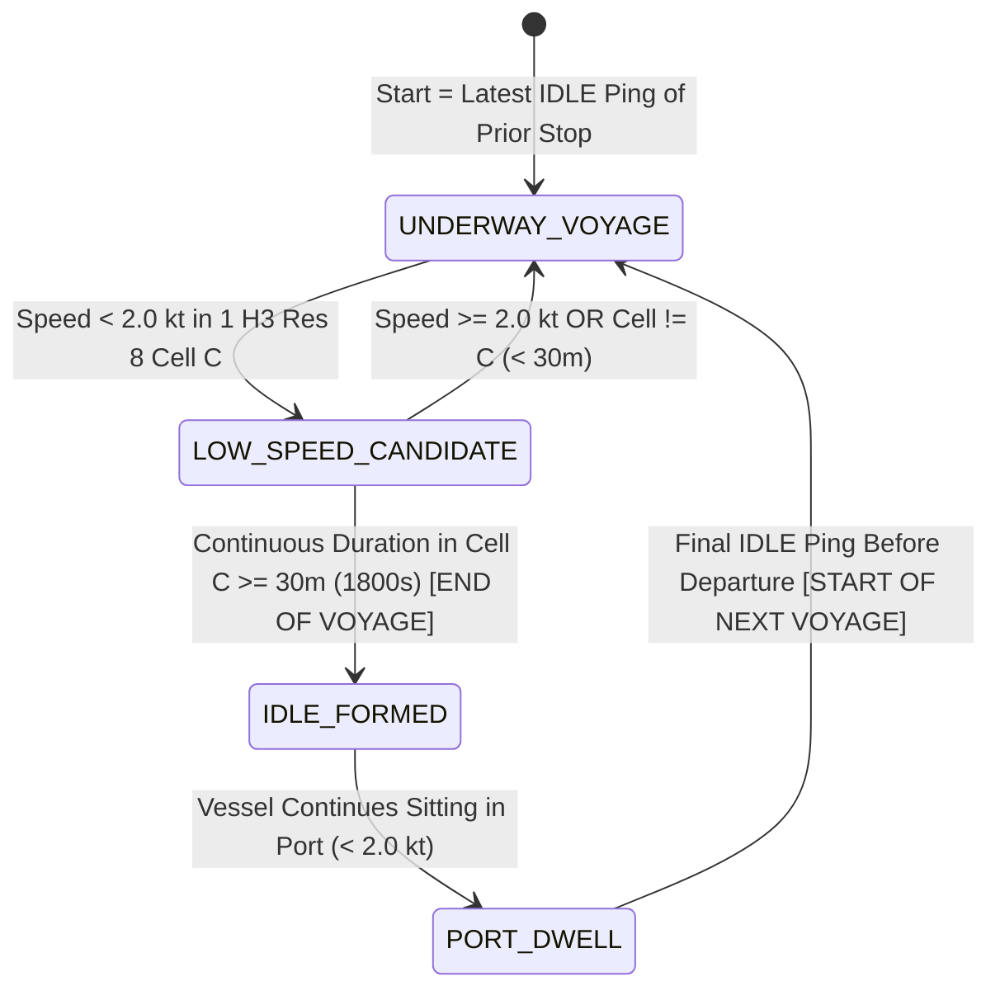

# Maritime Spatiotemporal Data Lakehouse Architecture (100GB+ DuckDB Engine)

A production-grade Medallion Architecture (`raw` $\to$ `bronze` $\to$ `silver` $\to$ `gold`) backed by an in-process columnar **DuckDB Lakehouse (`data/datalake.duckdb`)** engineered for **100+ vessels** and **100GB+ of AIS telemetry points**.

```text
data/
├── datalake.duckdb           # Columnar DuckDB Lakehouse (Bronze, Silver, Gold tables + compound indexes)
├── raw/                      # Landing Zone: Untransformed source CSVs and sensor dumps
│   ├── busan_test_raw.csv
│   └── new_camellia_30days_raw.csv
│
├── bronze/                   # Standardized Ingestion: 10-column canonical schema
│   ├── busan_bronze.csv
│   ├── new_camellia_bronze.csv
│   ├── koreavoyager8_bronze.csv
│   ├── pacificglory_bronze.csv
│   └── bronze_ingestion_audit.json
│
├── silver/                   # Enriched, IDLE-Detected & Stop-to-Stop Voyage Segmented
│   ├── silver_voyages.json   # Segmented Stop-to-Stop Silver Voyages (VOY-01..VOY-N)
│   ├── silver_voyages.csv    # Vectorized tabular export of Silver Voyages
│   ├── busan_silver.csv
│   ├── new_camellia_silver.csv
│   ├── koreavoyager8_silver.csv
│   ├── pacificglory_silver.csv
│   └── silver_kinematics_audit.json
│
└── gold/                     # Curated Intelligence & Analytical Model Serving Layer
    ├── voyages_summary.json  # 4 Core KPIs: Distance, Avg Speed, Prior Dwell, Safety Index
    ├── h3_corridors.json     # Trajectory corridors & idle mooring clusters (H3 Res 8)
    ├── markov_models/        # 3rd-Order Markov transition matrices & Top-3 predictions (Red/Orange/Yellow)
    ├── predictability/       # Jensen-Shannon Divergence route predictability
    └── fleet/                # Real-time fleet positions & derived kinematics
```

---

## 1. Silver-Tier IDLE & Stop-to-Stop Voyage Segmentation

Voyages and port dwell intervals are segmented directly in the **Silver Tier** (`silver_kinematics` and `silver_voyages` in `datalake.duckdb`, plus `data/silver/silver_voyages.json` and `data/silver/*_silver.csv`):



1. **Strict IDLE Rule**:
   - A vessel is `IDLE` (`is_idle = TRUE`, `motion_state = 'IDLE'`) when its speed (`SOG` or `calc_sog_kts`) is **`< 2.0 kt`** AND it remains within **1 single Uber H3 Resolution 8 cell (`h3_res8`)** continuously for **at least 30 minutes (`>= 1800 seconds`)**.
2. **Stop-to-Stop Voyage Boundaries**:
   - **Start of Voyage (`departure_utc`)**: The **latest timestamp the vessel was IDLE** in the departure stop (the final ping of the departure IDLE block right before departing).
   - **End of Voyage (`arrival_utc`)**: The **first moment an IDLE has formed (after the 30 minutes)** at the arrival stop (the exact ping where cumulative duration `< 2.0 kt` in that single `h3_res8` cell reaches `>= 1800 seconds`).
   - **Previous Dwell Time (`prior_dwell_time_hrs` / `prior_dwell_formatted`)**: Points occurring *after* the 30-minute IDLE formation threshold up until the last IDLE ping before the next departure belong to the port dwell state (`DWELL-01`, `DWELL-02`, ...) between voyages, and the stop duration is recorded as the **Previous Dwell Time** for the subsequent voyage.

---

## 2. 100GB+ & 100+ Vessel DuckDB Lakehouse Architecture

1. **Vectorized Columnar Processing**:
   - Uses zero-copy Pandas/Arrow registration (`con.register`) and DuckDB's multi-threaded C++ vectorized CSV/Parquet reader (`read_csv`), completely eliminating row-by-row SQL inserts.
2. **Multi-Core Pragmas & Compound Indexing**:
   - Configured with `SET threads`, `SET memory_limit = '8GB'`, and `SET preserve_insertion_order = false`.
   - Indexed on:
     - `idx_bronze_imo_time` on `bronze_telemetry (IMO, DateTime)`
     - `idx_silver_imo_time` on `silver_kinematics (IMO, DateTime)`
     - `idx_silver_voyage_time` on `silver_kinematics (voyage_id, DateTime)`
     - `idx_silver_global_voyage_time` on `silver_kinematics (global_voyage_id, DateTime)`
     - `idx_silver_h3` on `silver_kinematics (h3_res8)`
     - `idx_silver_voyages_imo` on `silver_voyages (imo, departure_utc)`

---

## 3. Analytics Placement Across the Medallion Tiers

1. **Raw (`data/raw/`)**: Zero analytics. Immutable landing zone for incoming AIS feeds.
2. **Bronze (`data/bronze/` & `bronze_telemetry`)**: Standardized 10-column schema (`[DateTime, LAT, LON, SOG, COG, Heading, Name, IMO, Type, Status]`), coordinate bounding, chronological sorting, and ingestion audits.
3. **Silver (`data/silver/`, `silver_kinematics` & `silver_voyages`)**:
   - Point-to-Point Derived Kinematics: Speed ($v_i = \Delta d_i / \Delta t_i$ in knots and $\text{m/s}$), Forward Azimuth Heading ($\theta_i$), Acceleration ($a_i$ in $\text{kts/min}$), Rate of Turn ($\text{ROT}_i$ in $^\circ/\text{min}$), and Point Safety Score ($0-100$).
   - Uber H3 Spatial Indexing (`h3_res8` & `h3_res7`).
   - Strict IDLE State Machine (`< 2.0 kt` in 1 `h3_res8` cell for `>= 1800s`) and Stop-to-Stop Voyage Segmentation (`VOY-01`, `VOY-02`, ...).
4. **Gold (`data/gold/`, `gold_voyages` & `gold_markov_transitions`)**:
   - 4 Mission-Critical Voyage KPIs (Distance, Avg Speed, Prior Dwell Time, Safety Index $0-100$).
   - 3rd-Order Markov Chain Transitions ($P(C_{t+1} \mid C_t, C_{t-1}, C_{t-2})$) & Top-3 Prediction Spectrum (Red `#ef4444` = Rank 1, Orange `#f97316` = Rank 2, Yellow `#eab308` = Rank 3).
   - Jensen-Shannon Divergence (JSD) Route Predictability Index & Real-Time Fleet Operational State.
